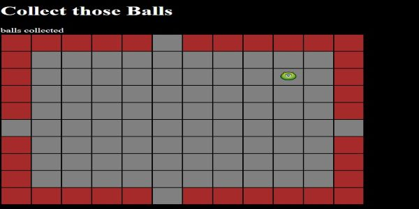

# Ball Board

A small grid game: move the player with the arrow keys and collect the balls that keep appearing on the board.

**[▶ Play the live demo](https://avraham186.github.io/ball-board/)**

## Features

- Keyboard controls (arrow keys)
- New balls spawn at random positions on a timer
- Score counter of collected balls
- Sound effect on every collected ball
- Restart button

## Tech

- Vanilla JavaScript (board as a 2D matrix, DOM rendering)
- HTML5, CSS3

## Run locally

No build step: clone the repo and open `index.html` in a browser.
